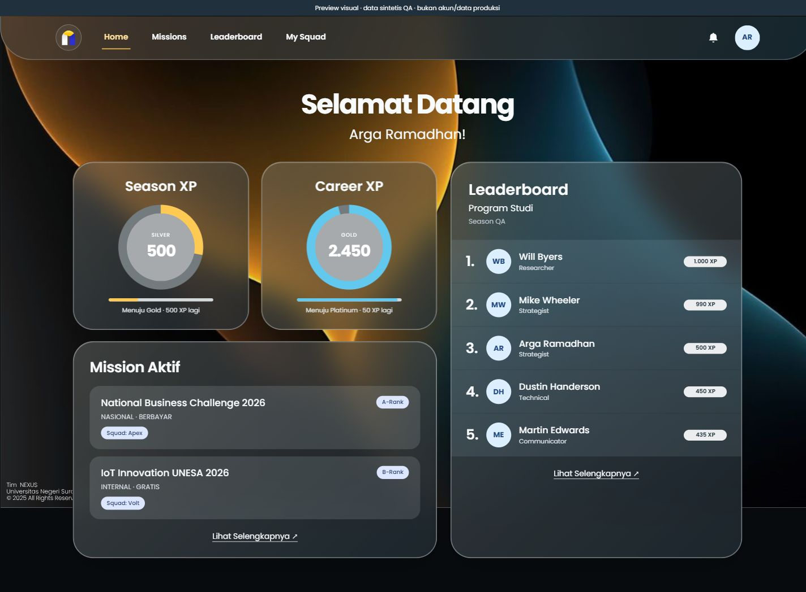
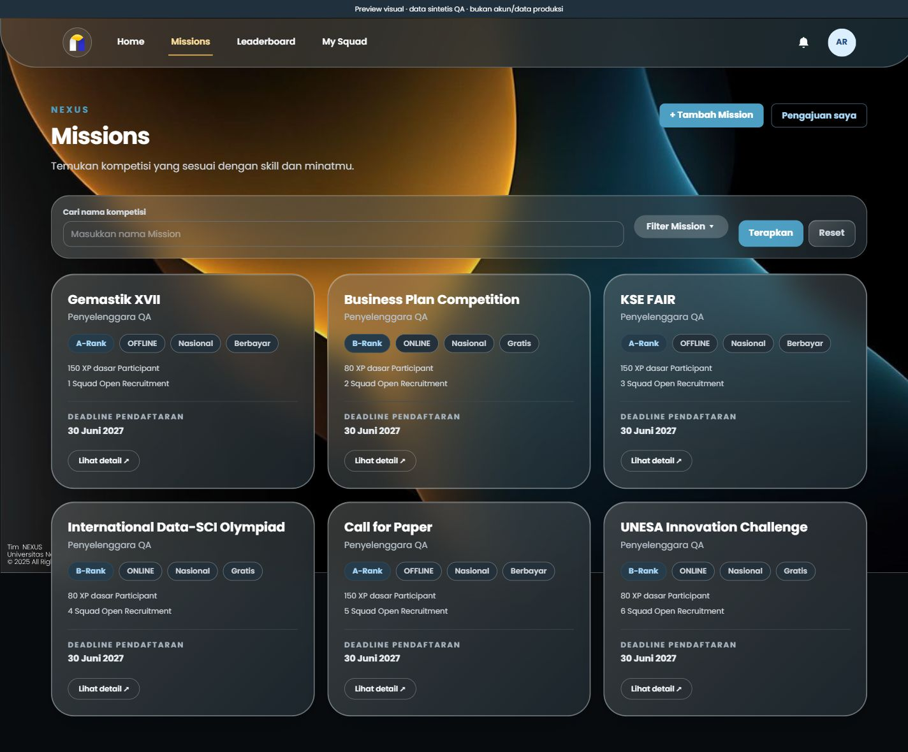
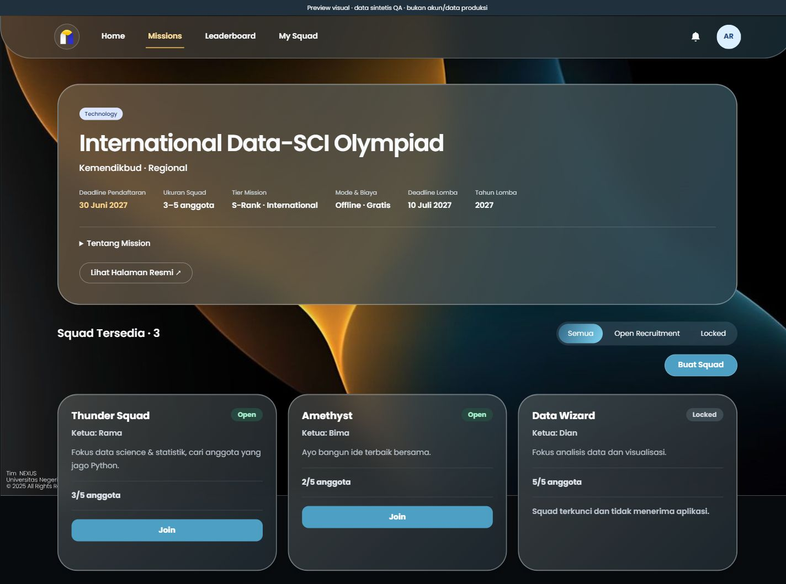
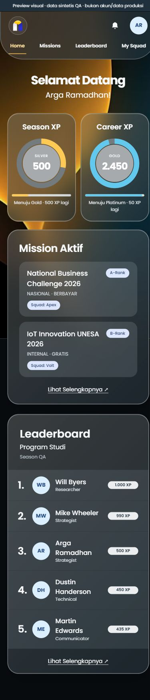
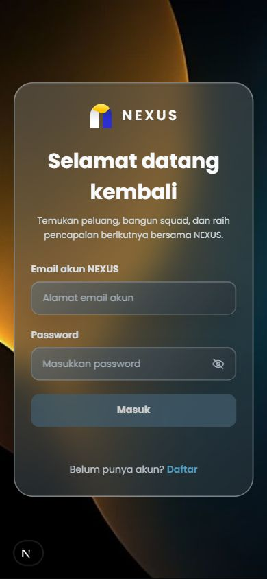

# Frontend NEXUS — handoff 11 Oktober 2026

Branch: `feat/nexus-glass-frontend`. Baseline backend: `2245ac5` (main).
Folder kerja: `C:\Users\Asus\OneDrive\Documents\Kuliah\LPPM\Nexus\website`.

## Perubahan

- Poppins, background dan logo dari aset pengguna; glassmorphism lebih terang, blur 26px, bezel abu terang. Token surface/warna dipusatkan sehingga form dan halaman existing memakai tema konsisten.
- Navigasi Home/Missions/Leaderboard/My Squad, notifikasi, profil dan akses review admin; tata letak responsive.
- Home memakai data nyata dari profiles, career_xp_totals, seasons, current_seasonal_xp_totals, rank_rules, squad_members, squads, missions serta RPC get_current_leaderboard. Misi aktif di kiri bawah kartu XP, leaderboard program studi di kanan. Maksimal tiga misi terbaru dan lima peringkat dalam ringkasan.
- XP ring dan progress bar dihitung dari rank_rules, dengan batas 0–100. Progres dibulatkan ke bawah agar tidak mengklaim rank berikutnya sebelum threshold tercapai. Rank tertinggi tidak diberi target buatan.
- Login memakai form, validasi, Supabase Auth, dan guard existing.
- Missions memakai grid tiga/dua/satu kolom, search GET serta filter kategori/tier/mode/biaya yang dapat dibuka. Input tetap dipertahankan lewat URL.
- Mission Detail menampilkan informasi asli, deadline, rentang anggota, tier, mode/biaya, deskripsi dan tautan resmi. Filter Semua/Open/Locked membatasi tampilan squad; count recruitment total tetap terpisah dari subset yang ditampilkan. Kartu menampilkan hitungan anggota ACTIVE/kapasitas.
- Create Squad ditampilkan sebagai tombol ringkas sebelum form dibuka; seluruh field requirement Class/slot, pending, feedback, dan Server Action dipertahankan.
- Loading dan error boundary bersama dengan tombol coba lagi.

Scope PRD: UI-01, UI-02, UI-04, UI-05, UI-07, UI-09, U01/U03/U04/U05/U06/U20. Tema bersama juga memengaruhi halaman existing lain; alur halaman tersebut masih memerlukan regresi dengan akun uji.

## Verifikasi

| Pemeriksaan | Hasil / batas |
| --- | --- |
| npm run lint | PASS |
| npm run build (termasuk TypeScript) | PASS |
| git diff --check | PASS |
| Login actual browser | Form kosong disabled; input valid mengaktifkan submit; toggle password bekerja; tidak mengirim kredensial |
| Desktop 1440×900 dan mobile 390×844 | Dashboard, login dan Missions diperiksa; tidak ada overflow horizontal; grid Missions tiga/satu kolom |
| Mission Detail visual | Overview, Create Squad collapsed dan SquadList menggunakan komponen asli pada fixture terisolasi; filter Locked menampilkan kartu FULL |
| Search/filter Missions | Filter B dan pencarian tanpa hasil menggunakan page.tsx asli dengan Supabase fixture; respons database live belum diuji |
| XP boundary | 299 Bronze, 300/500/999 Silver, 1000/2450 Gold, 2500 Platinum, 6000 Diamond; menggunakan fixture rank rules kanonik |
| Empty/error Home | Tanpa season/misi menampilkan empty state; kegagalan XP/misi/leaderboard mempunyai feedback masing-masing |
| Supabase end-to-end dan authorization | NOT RUN: .env.local dan akun testing belum diberikan |
| Create/Join/accept/reject/upload/chat/admin | NOT RUN pada backend live; action dan handler existing dipertahankan |

Fixture dan server visual berada di luar repository; tidak ada route demo, bypass autentikasi, akun hardcode, atau seed QA pada aplikasi. Screenshot di bawah menampilkan data sintetis dan diberi label QA. Screenshot login diambil dari halaman aplikasi sebenarnya.

## Preview

## Integrasi berikutnya

1. Owner memberikan environment development melalui .env.local dengan NEXT_PUBLIC_SUPABASE_URL dan NEXT_PUBLIC_SUPABASE_PUBLISHABLE_KEY.
2. Owner menyediakan dua akun STUDENT dan satu ADMIN serta menentukan izin data testing.
3. Jalankan regresi login, onboarding, Home, discovery/detail, create/join/recruitment, profile, leaderboard, notifications dan admin. Verifikasi aggregate count squad sesuai RLS.
4. Review PR, selesaikan pengujian runtime lalu merge. Main belum diubah oleh pekerjaan ini.

Poster Mission belum dipasang: dokumen pengajuan tersimpan privat dan kontrak belum menyediakan poster publik di discovery. Jangan memasangkan poster contoh ke Mission aktual atau membuka bucket bukti privat untuk mengikuti screenshot.

PR #28 mendokumentasikan kontrak backend pada baseline yang sama; pada awal pengerjaan belum merged. Dokumen tersebut dapat dibaca di Files changed sebelum masuk main. Tidak ada perubahan API, Server Action, schema, migration atau RLS dalam PR frontend ini; perubahan query page hanya membaca data sesuai pola existing.

Instalasi dependency melaporkan 9 advisory (8 high, 1 critical) pada lockfile existing. Tidak dilakukan upgrade dependency dalam perubahan UI ini.
